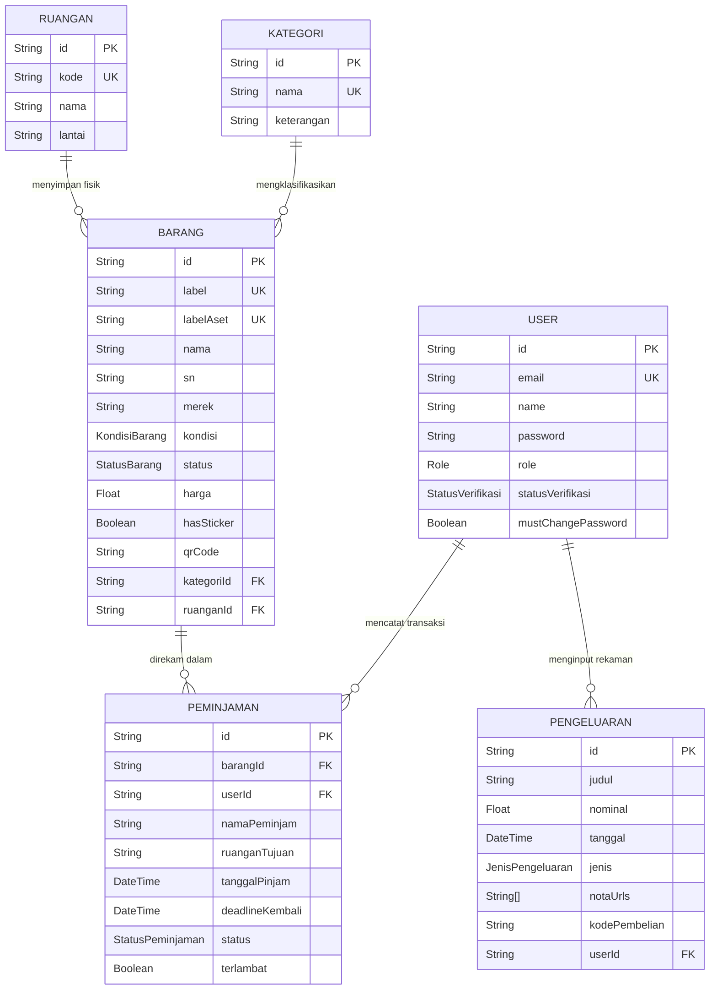

# Dokumen Arsitektur & Laporan Sistem: Aplikasi Manajemen Aset FTI UKSW

Dokumen ini merupakan laporan komprehensif berstandar profesional yang menjabarkan spesifikasi teknis, arsitektur sistem, alur kerja (business process flow), desain basis data (ERD), serta pedoman operasional dari aplikasi Manajemen Aset Fakultas Teknologi Informasi (FTI) UKSW.

---

## 1. Pendahuluan

### 1.1. Tujuan Sistem
Aplikasi Manajemen Aset FTI dirancang untuk mendigitalisasi dan mensentralisasi seluruh tata kelola aset inventaris fisik (komputer, mebel, dsb.) dan pelacakan pengeluaran operasional di lingkungan fakultas. Sistem ini bertujuan untuk mengeliminasi pencatatan manual, mengurangi risiko aset hilang, serta mempermudah audit secara instan (*real-time*).

### 1.2. Cakupan Sistem
Sistem memfasilitasi siklus hidup aset mulai dari pengadaan (Laporan Pengeluaran), registrasi aset (Pembuatan QR Code), pemindahan (Mutasi Lokasi), peminjaman (Aktivitas Keluar-Masuk), hingga pelaporan akhir untuk pihak eksekutif (Universitas).

---

## 2. Arsitektur Teknis (Tech Stack)

Aplikasi dibangun menggunakan arsitektur web modern dengan basis **Full-Stack Serverless-ready**:
- **Framework Frontend/Backend:** Next.js (App Router)
- **Desain & UI:** TailwindCSS dipadukan dengan desain *Glassmorphism* modern (komponen *Unified Glass*)
- **Database ORM:** Prisma ORM
- **Database Engine:** PostgreSQL
- **Security:** Autentikasi kustom menggunakan `bcryptjs` untuk enkripsi sandi
- **Utilitas Data:** Ekspor/Impor format *spreadsheet* (XLSX, CSV) menggunakan `exceljs`, serta generasi kode QR dinamis menggunakan `qrcode`

---

## 3. Manajemen Pengguna & Hak Akses (RBAC)

Keamanan operasional diatur dengan konsep *Role-Based Access Control* (RBAC) yang ketat. Semua lalu-lintas data dilindungi oleh *Middleware* untuk mencegah akses tidak sah.

| Peran (Role) | Otorisasi & Hak Akses | Deskripsi Profil Pengguna |
| :--- | :--- | :--- |
| **ADMIN** | Sistem Penuh (*Full CRUD*) | Admin fakultas yang dapat memverifikasi user, mengatur akun tim, mengedit data aset, mengatur ruangan & kategori, serta mengelola pencatatan keuangan/pengeluaran FTI. |
| **TEKNISI** | Operasional Harian | Petugas lapangan yang bertugas mengeksekusi pemindahan barang, mencatat kondisi barang, serta melakukan pencatatan proses peminjaman. Tidak dapat mengakses data keuangan maupun mengubah hak akses user. |
| **UNIVERSITAS** | *Executive Read-Only* | Pihak auditor atau rektorat yang bertugas meninjau laporan keuangan (Nota & Pengeluaran) serta memantau riwayat peminjaman aset. Tidak dapat merusak atau mengubah data apa pun. |

### Alur Autentikasi Khusus:
Sistem memiliki kontrol registrasi *Closed-Environment*. Pengguna yang baru mendaftar tidak bisa langsung masuk ke sistem (status `PENDING`). Mereka harus disetujui (diberi status `APPROVED`) secara manual oleh **Admin** sebelum dapat menggunakan sistem.

---

## 4. Alur Proses Bisnis Utama (Business Process Flow)

### 4.1. Alur Pengadaan & Registrasi Aset Baru
1. Pembelian dilakukan secara fisik. Admin mencatat pengeluaran di **Laporan Pengeluaran** dan mengunggah foto nota bukti.
2. Barang fisik tiba. Admin / Teknisi meregistrasi barang di menu **Manajemen Aset**.
3. Sistem secara otomatis men-generate **QR Code** aset.
4. Admin menggunakan fitur **Bulk Print** (Cetak Massal) untuk mencetak stiker barcode yang akan ditempel pada fisik barang.

### 4.2. Alur Mutasi (Pindah Ruangan) & Inspeksi
1. Teknisi menemukan aset di ruangan yang salah atau aset tersebut akan direlokasi.
2. Teknisi menggunakan gawai pintar (kamera/scanner) untuk mengakses fitur **Pindah Barang** di sistem.
3. Setelah barang dipindai, Teknisi memilih ruangan tujuan baru di dalam sistem.
4. Data diperbarui (*update*) secara instan ke server; riwayat (*timestamp*) kapan aset dipindah akan terekam.

### 4.3. Alur Peminjaman Aset
1. Mahasiswa atau Staf ingin meminjam alat/inventaris.
2. Teknisi masuk ke menu **Peminjaman** dan mendaftarkan peminjaman, mencatat nama mahasiswa, tujuan ruangan, barang yang dipinjam, serta tenggat waktu (deadline) kembali.
3. Selama dipinjam, status barang terkunci menjadi `DIPINJAM` sehingga aset yang sama tidak dapat dipinjam oleh orang lain.
4. Setelah barang dikembalikan, sistem menandai peminjaman sebagai `SELESAI` dan memeriksa apakah barang dikembalikan dalam periode `Terlambat`.

---

## 5. Desain Basis Data & ERD (Entity Relationship Diagram)

Sistem dirancang dengan normalisasi database tingkat tinggi guna menjaga konsistensi referensial (*Referential Integrity*).

### Relasi & Kendala Bisnis (Constraints):
- **Barang & Kategori (1:N):** Setiap aset wajib memiliki satu klasifikasi Kategori. Pencegahan *Orphaned Data*: Kategori tidak bisa dihapus jika masih ada barang di dalamnya.
- **Barang & Ruangan (1:N):** Barang terkait pada Ruangan tertentu secara opsional. Aset yang rusak (*Kondisi: Rusak Berat*) mungkin tidak direlasikan ke ruangan mana pun karena digudangkan.
- **Audit Trail User:** Entitas `User` wajib disematkan pada pencatatan `Peminjaman` dan `Pengeluaran` sebagai tanda identitas operator/staf mana yang bertanggung jawab atas entri data tersebut.

---

## 6. Fitur Unggulan Sistem

- **Unified Glass Interface:** Pendekatan *User Interface* yang menyatukan area filter, pencarian (*search*), serta penayangan (*data table*) ke dalam satu kontainer modern berbasis *glassmorphism* agar proses interaksi terasa lebih intuitif.
- **Automated QR Generation & Mass Printing:** Secara otonom menerbitkan matriks QR untuk identifikasi mesin. Sistem menyertakan format *print-ready* yang dinamis mendeteksi area cetak dan tata letak per baris untuk mencetak langsung puluhan stiker QR tanpa membuang ruang kertas.
- **Real-time Pagination (Cursor & Offset):** Optimasi basis data yang menggunakan pendekatan indeks yang akurat (kursor berbasis ID) untuk melayani lalu lintas pencarian besar tanpa membebani performa server.
- **Pre-flight Check Import & Transparent Reporting:** Fitur unggulan saat memasukkan (*import*) data massal via Excel/CSV. Sistem melakukan pratinjau *error* secara seketika (*Pre-flight Check*) yang dipecah halamannya dengan navigasi tombol *Sebelumnya/Selanjutnya* (*Next/Prev Pagination*). Setelah data berhasil diproses (*Push*), sistem memberikan Laporan Transparan bergaya *Bento Grid* yang mengelompokkan secara jelas rincian data baru (ditambahkan), data lama yang terdeteksi perubahan isinya (diperbarui), data yang diabaikan karena identik (*skipped*), serta kegagalan sistematis (*error*).

---

## 7. Keamanan & Integritas (Security Standard)

1. **Proteksi Akses (Route Guarding & API Guard):** Halaman seperti `/admin` atau `/universitas` dijaga oleh aturan logika di sisi *Server Components*. Selain itu, seluruh rute _backend_ API dilindungi oleh *guard* tersentralisasi (`checkApiAuth`) yang akan menolak akses modifikasi data (HTTP 403 Forbidden) apabila pengguna berstatus `PENDING` atau jika peran (*role*) tidak sesuai (contoh: *role* `UNIVERSITAS` tidak bisa mengeksekusi POST Peminjaman barang).
2. **Validasi Data Ekstrem (Anti-Glitches):** Modul API memiliki validasi keamanan terhadap _input_ anomali untuk menjaga integritas neraca aset. Sistem akan menolak masukan harga bernilai negatif maupun jumlah aset kurang dari satu (1).
3. **Kriptografi Kredensial:** Seluruh kombinasi sandi (`password`) di-*hash* satu arah (*one-way salted hash*) menggunakan `bcryptjs`. Pengembang atau pengelola pangkalan data (DBA) tidak dapat melihat sandi asli staf.
4. **Penyitaan Sesi (Force Relogin):** Fitur pencegahan pembajakan yang diterapkan ketika admin menekan tuas "Reset Sandi", maka sesi staf tersebut otomatis menghendaki penggantian sandi mandiri di *login screen* berikutnya (`mustChangePassword` *flags*).
